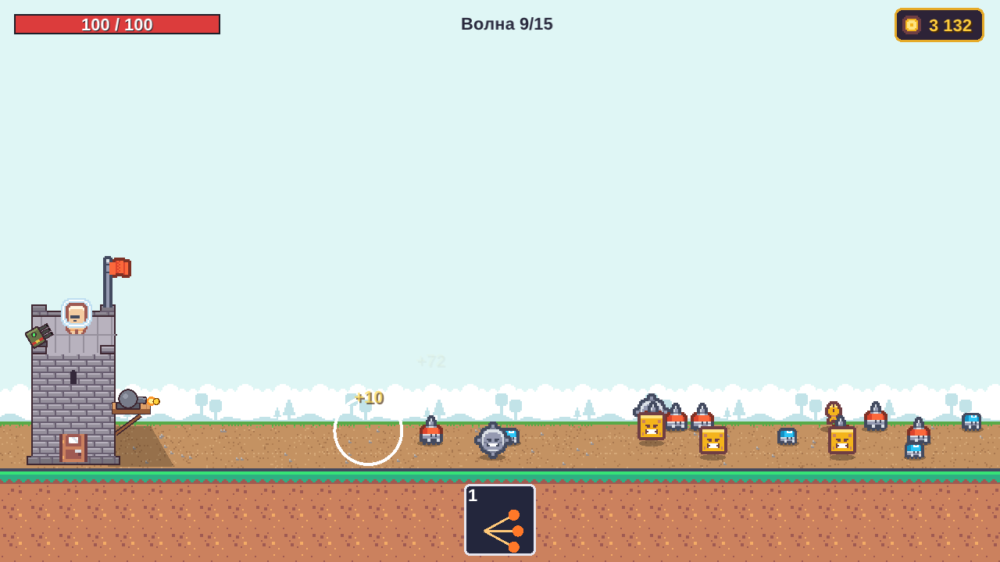

# Tower Defense (C++ / OpenGL)

Жоламанов Әнуар, КН23.01 — Компьютерлік графика



## ▶ Ойынды іске қосу

Ештеңе орнатудың қажеті жоқ: архивті жүктеп, ашып, `game` файлын іске қосу жеткілікті.

| Жүйе | Жүктеу | Іске қосу |
|------|--------|-----------|
| **Windows** | [TowerDefense-windows.zip](https://github.com/Anuar2000/tower-defense/releases/latest/download/TowerDefense-windows.zip) | Архивті ашып, `TowerDefense\game.exe` файлын екі рет басу. «Windows protected your PC» терезесі шықса: **More info → Run anyway** |
| **macOS** | [TowerDefense-macos.zip](https://github.com/Anuar2000/tower-defense/releases/latest/download/TowerDefense-macos.zip) | Архивті ашып, Terminal-да: `xattr -cr ~/Downloads/TowerDefense && ~/Downloads/TowerDefense/game` |
| **Linux** | [TowerDefense-linux.zip](https://github.com/Anuar2000/tower-defense/releases/latest/download/TowerDefense-linux.zip) | `unzip TowerDefense-linux.zip && ./TowerDefense/game` |

`assets` папкасы `game` файлының жанында тұруы керек.

## Ойын туралы

Мұнара сол жақта, жаулар оң жақтан келеді. 15 толқын: бәрінен өтсең — жеңіс, мұнара құласа — жеңіліс.
Толқындар арасында дүкенде зеңбірек, мұнара және навыктар жақсартылады.

Жаулар: қарапайым, жарқанат, робот, рой, қалқанды (зеңбірек оғынан 50% зиян алады), емші (көршілерін емдейді), бөлінетін (өлгенде 3 жауға бөлінеді), босс (5, 10, 15-толқындарда).

## Басқару

- **Тінтуірдің сол жақ батырмасы** жауға — сол жау басым нысана болады
- **1–5** — навыктар: Залп, Заморозка, Авиаудар, Щит, Перегрев (дүкеннің «Навыки» қойындысында сатып алынады)
- **Магазин / Следующая волна** — толқындар арасындағы батырмалар
- **ESC** — пауза мәзірі, **R** — жеңіс/жеңілістен кейін қайта бастау

## Бастапқы кодтан жинау

CMake 3.20+ және C++20 компиляторы керек. GLFW мен GLM-ді CMake GitHub-тан өзі жүктейді.

```
cmake -B build
cmake --build build --config Release
```

Windows-та — Visual Studio 2022 (File → Open → Folder), Ubuntu-да алдымен: `sudo apt install build-essential cmake libgl1-mesa-dev xorg-dev`.
Нәтиже: `build/bin/game` (Visual Studio-да `build/bin/Release/game.exe`).

## Код (`src/`)

- `render.cpp` — OpenGL: шейдер, VAO/VBO, ортографиялық матрица (glm), текстуралар, мәтін (stb_truetype)
- `main.cpp` — терезе (GLFW), ойын циклі, HUD
- `settings.h` — ойынның барлық сандары: жаулар, 15 толқын, жақсартулар, навыктар
- `tower.cpp`, `enemies.cpp`, `turret.cpp`, `waves.cpp`, `skills.cpp`, `shop.cpp`, `menu.cpp`, `sounds.cpp` — мұнара, жаулар, ату, толқындар, навыктар, дүкен, мәзір, дыбыс

Ассеттер: Kenney (CC0), музыка — Juhani Junkala (CC0), қаріп — Liberation Sans (SIL OFL). Лицензиялар `assets/` ішінде.
